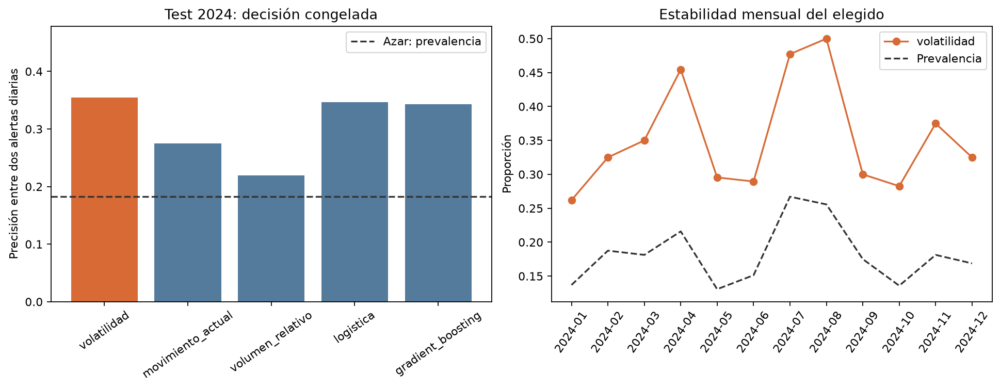

# Entrega 3 - Machine Learning

## 1. Qué problema resuelve el modelo

MarketPulse ayuda a un analista a decidir qué activos revisar al cierre. La funcionalidad es clasificación binaria con ranking: anticipar un movimiento absoluto ajustado de al menos el 2 % en la siguiente sesión y priorizar dos de los ocho activos diarios. El evento futuro es un proxy de relevancia; no una etiqueta verdadera de anomalía ni una predicción de dirección. Concreta una primera evaluación del objetivo de la Entrega 2.

El valor esperado es encontrar más eventos con el mismo presupuesto de revisión humana. No se evalúa rentabilidad, ejecución, costes de compraventa ni una estrategia financiera.

## 2. Datos de entrada y salida

Se utiliza `data/gold/marketpulse.csv`, generado por [el notebook de Entrega 2](../../notebooks/02_marketpulse_datos_y_preparacion.ipynb). Gold contiene 5856 filas y ocho activos. SHA-256: `bd484aaf16a298f06935f6fe0fe37a08a5629577ae56ded31a13ecb446e41418`. La adquisición y los entregables anteriores se conservan intactos.

Entradas: `daily_return`, `intraday_range_pct`, `relative_volume`, `volatility_20`, `distance_to_high_20` y `distance_to_low_20`. Son variables relativas conocidas al cierre de t. Se excluyen ticker, fecha, niveles absolutos y cualquier etiqueta o estadística futura como predictores. La salida es un score para ordenar los activos y dos marcas de prioridad por día.

Objetivo: `y_t = 1[abs(adj_close_(t+1)/adj_close_t - 1) >= 0.02]`, por activo. Se eliminan las ocho últimas filas sin siguiente cierre: quedan 5848 registros supervisados antes de purgar fronteras. El último día sí permite inferencia histórica, sin evaluar su acierto.

Se comprueban claves únicas, valores finitos, precios positivos y sesiones comunes a todos los activos. Se purgan 16 filas cuyas etiquetas cruzarían los cortes temporales. El escalado se ajusta dentro del Pipeline solo con entrenamiento. Los indicadores previos ya vienen de Gold. Persisten sesgos de selección y supervivencia, concentración tecnológica, mezcla de acciones con ETF y ajustes retrospectivos de Yahoo: no es una base point-in-time ni representa todo el mercado. No se recopilan nuevos datos personales.

## 3. Baseline y selección de modelos

Se comparan reglas sin entrenamiento: mayor volatilidad previa, mayor rentabilidad absoluta actual y mayor volumen relativo. Volatilidad controla la persistencia del riesgo y evita una referencia artificialmente débil. El azar tiene precisión esperada igual a la prevalencia.

Alternativas: logística regularizada con StandardScaler dentro del Pipeline, C=1 y máximo 2000 iteraciones; HistGradientBoostingClassifier con 100 iteraciones, tasa 0.05, 7 hojas, mínimo 30 registros por hoja, L2=1 y early_stopping=False para no crear una validación aleatoria interna. Semilla 42. No se realiza búsqueda de hiperparámetros ni se reajusta el umbral del evento después de ver test.

Regla fijada antes del test: escoger el mejor baseline y el mejor ML por P@2 en validación, usando AP y orden estable como desempates. El ML debe mejorar al baseline al menos un punto porcentual para justificar más complejidad.

Se elige el baseline **volatilidad**. El mejor ML de validación (logistica) cambia la P@2 en -0.60 puntos porcentuales frente al baseline; no alcanza la mejora mínima fijada de 1 punto que justificaría más complejidad.

Validación 2023, ajustando con 2022:

| index | precision_at_2 | recall_at_2 | average_precision | roc_auc | lift_vs_azar |
| --- | --- | --- | --- | --- | --- |
| volatilidad | 0.3213 | 0.4103 | 0.3331 | 0.7031 | 1.6410 |
| movimiento_actual | 0.2831 | 0.3615 | 0.2657 | 0.5798 | 1.4462 |
| volumen_relativo | 0.2209 | 0.2821 | 0.2585 | 0.5525 | 1.1282 |
| logistica | 0.3153 | 0.4026 | 0.3511 | 0.7030 | 1.6103 |
| gradient_boosting | 0.3052 | 0.3897 | 0.3366 | 0.6822 | 1.5590 |

## 4. Validación y evaluación

Separación por fechas completas, conservando todos los activos del día en el mismo conjunto. Se eliminan etiquetas que caerían en el siguiente periodo. No se barajan filas. Tras seleccionar con 2023, se reajusta con observaciones y etiquetas anteriores a 2024; eso permite recuperar la última sesión de 2022, ya conocida antes de test. Los hiperparámetros no cambian.

| conjunto | filas | sesiones | inicio | fin | ultima_etiqueta | eventos | prevalencia |
| --- | --- | --- | --- | --- | --- | --- | --- |
| train | 1832 | 229 | 2022-02-02 | 2022-12-29 | 2022-12-30 | 737 | 0.4023 |
| validacion | 1992 | 249 | 2023-01-03 | 2023-12-28 | 2023-12-29 | 390 | 0.1958 |
| test | 2008 | 251 | 2024-01-02 | 2024-12-30 | 2024-12-31 | 367 | 0.1828 |

Métrica primaria: precisión entre las dos alertas diarias. Recall@2 mide cobertura; AP y ROC-AUC, discriminación global. Lift es P@2 / prevalencia y no una rentabilidad. La selección uniforme aleatoria tiene precisión esperada igual a la prevalencia. No se usa accuracy porque puede ocultar errores con clases desbalanceadas. La política siempre propone dos activos: es una cola de revisión, no afirma que haya dos anomalías cada día.

Test 2024 fuera de entrenamiento; la tabla de todos los métodos es descriptiva y no cambia la selección:

| index | precision_at_2 | recall_at_2 | average_precision | roc_auc | lift_vs_azar |
| --- | --- | --- | --- | --- | --- |
| volatilidad | 0.3546 | 0.4850 | 0.3520 | 0.7063 | 1.9401 |
| movimiento_actual | 0.2749 | 0.3760 | 0.2588 | 0.5886 | 1.5041 |
| volumen_relativo | 0.2191 | 0.2997 | 0.2246 | 0.5448 | 1.1989 |
| logistica | 0.3466 | 0.4741 | 0.3745 | 0.7227 | 1.8965 |
| gradient_boosting | 0.3426 | 0.4687 | 0.3822 | 0.7249 | 1.8747 |

En test, el elegido consigue P@2=0.355, recall@2=0.485 y lift=1.94 frente al azar. La diferencia de P@2 frente al baseline es +0.00 puntos. El mejor ML de validación frente al baseline presenta un IC95% aproximado [-2.99, +1.59] puntos. Son resultados del snapshot y no demuestran utilidad operativa general.

Matriz de confusión del elegido: positivo predicho = estar en las dos prioridades diarias.

| index | sin_alerta | alerta |
| --- | --- | --- |
| sin_evento | 1317 | 324 |
| evento | 189 | 178 |

Errores del elegido: TP=178, FP=324, FN=189. Un falso positivo consume revisión sin un movimiento posterior >=2 %; un falso negativo omite un evento. No todo movimiento >2 % es una anomalía real y un movimiento menor podría seguir siendo interesante. En `ejemplos_errores.csv` se muestran cinco FP con mayor score y cinco FN con mayor magnitud futura. No se atribuyen a noticias o resultados empresariales sin haberlos observado.

| symbol | eventos | alertas | tp | fp | fn | precision | recall |
| --- | --- | --- | --- | --- | --- | --- | --- |
| AAPL | 31 | 52 | 5 | 47 | 26 | 0.096 | 0.161 |
| AMZN | 54 | 72 | 18 | 54 | 36 | 0.250 | 0.333 |
| GOOGL | 41 | 29 | 4 | 25 | 37 | 0.138 | 0.098 |
| META | 62 | 109 | 35 | 74 | 27 | 0.321 | 0.565 |
| MSFT | 28 | 0 | 0 | 0 | 28 | nan | 0.000 |
| NVDA | 121 | 240 | 116 | 124 | 5 | 0.483 | 0.959 |
| QQQ | 23 | 0 | 0 | 0 | 23 | nan | 0.000 |
| SPY | 7 | 0 | 0 | 0 | 7 | nan | 0.000 |

NVDA concentra 240 de 502 alertas (47.8%). No reciben alertas MSFT, QQQ, SPY; en ellos se omiten 58 eventos. Esto favorece la volatilidad estructural y limita la interpretación como detector de anomalías relativas a cada activo. La P@2 mensual oscila entre 26.2% (2024-01) y 50.0% (2024-08). El mayor FN mostrado es META el 2024-02-01, con movimiento posterior de 20.3% y rango 3: baja volatilidad previa no descarta un salto. Los FP de mayor score ilustran que alta volatilidad reciente no garantiza un evento en la sesión siguiente. No se atribuye el salto a una noticia no observada. La estabilidad mensual se registra en `estabilidad_mensual.csv`. Los cortes no se utilizan para modificar el modelo.

El intervalo de diferencias usa bootstrap pareado de bloques de cinco sesiones, 2000 repeticiones y semilla 42. Mantiene juntos los activos de un día y dependencia temporal local; no supone ocho series independientes. Si el elegido es el propio baseline, la diferencia consigo mismo es cero, por eso también se publica la del mejor ML de validación. Un único año, universo pequeño y umbral fijo no bastan para acreditar robustez. Se reconoce el cambio de prevalencia entre periodos. Quedan pendientes otros universos y periodos, validación walk-forward, etiquetas point-in-time y evaluación del coste de revisión.

## 5. Decisión y uso en el producto

Se elige el baseline **volatilidad**. El mejor ML de validación (logistica) cambia la P@2 en -0.60 puntos porcentuales frente al baseline; no alcanza la mejora mínima fijada de 1 punto que justificaría más complejidad.

En test, el elegido consigue P@2=0.355, recall@2=0.485 y lift=1.94 frente al azar. La diferencia de P@2 frente al baseline es +0.00 puntos. El mejor ML de validación frente al baseline presenta un IC95% aproximado [-2.99, +1.59] puntos. Son resultados del snapshot y no demuestran utilidad operativa general.

Es suficiente para un prototipo académico de priorización con evaluación reproducible; no para decisiones financieras automáticas ni para garantizar detección general de anomalías. La mejora frente al baseline se distingue de la mejora frente al azar. No se proclama superioridad de ML si los resultados no la respaldan, ni se cambia de método al mirar test. No se despliega un modelo ni se construye el frontal.

El frontal consumiría `as_of`, `method`, `horizon`, `daily_review_budget` y una lista `assets` con `symbol`, `ranking_score`, `rank`, `priority` y contexto de volumen relativo, rentabilidad actual y volatilidad. Un score alto se revisa antes. No se presenta como probabilidad calibrada y su escala depende del método. El contexto describe señales observadas: no es una atribución causal del modelo. No se emite dirección, orden de compra/venta o retorno esperado.

[Ejemplo JSON](../../results/03_machine_learning/ejemplo_salida_producto.json): sesión histórica 2024-12-31, no una alerta actual. El baseline no necesita entrenamiento; los modelos comparados se ajustaron con etiquetas hasta 2023-12-29, sin reajustar con test. El JSON indica explícitamente si el método requiere un estimador ajustado.

**Reproducción:** instalar `requirements.txt`; abrir [el notebook de Entrega 3](../../notebooks/03_marketpulse_machine_learning.ipynb), seleccionar `.venv/Scripts/python.exe` y ejecutar todas las celdas. Si falta Gold, ejecutar primero el notebook 02. El experimento no necesita red una vez disponibles Gold y las dependencias. El notebook contiene todo el código y regenera este documento y las evidencias. Versiones, semillas, parámetros y huellas del Gold y del código se guardan en [experimento.json](../../results/03_machine_learning/experimento.json). Otra descarga puede cambiar los datos y requiere reevaluación.

Evidencias en `results/03_machine_learning/`: particiones, métricas de validación y test, selección congelada, matriz de confusión, errores por activo, estabilidad mensual, ejemplos de errores, figura, JSON del producto y metadatos. No se guardan datasets masivos ni un modelo serializado.

Referencias técnicas: [prevención de leakage con pipelines](https://scikit-learn.org/stable/common_pitfalls.html) y [HistGradientBoostingClassifier](https://scikit-learn.org/stable/modules/generated/sklearn.ensemble.HistGradientBoostingClassifier.html).
